# Android screens

What the app looks like, and the model it presents.

Every screenshot here is generated from fixture data — invented personas, invented
transcripts — never from a real install. See [Regenerating these](#regenerating-these).

For the model itself, and how it is stored, see [Agents](../../../backend/docs/agents.md) in the
backend docs. The short version: a **persona** is how the assistant sounds, the **assistant** is
what it can do, and switching persona changes who answers without changing the model, the tools or
the memory.

---

## Chats

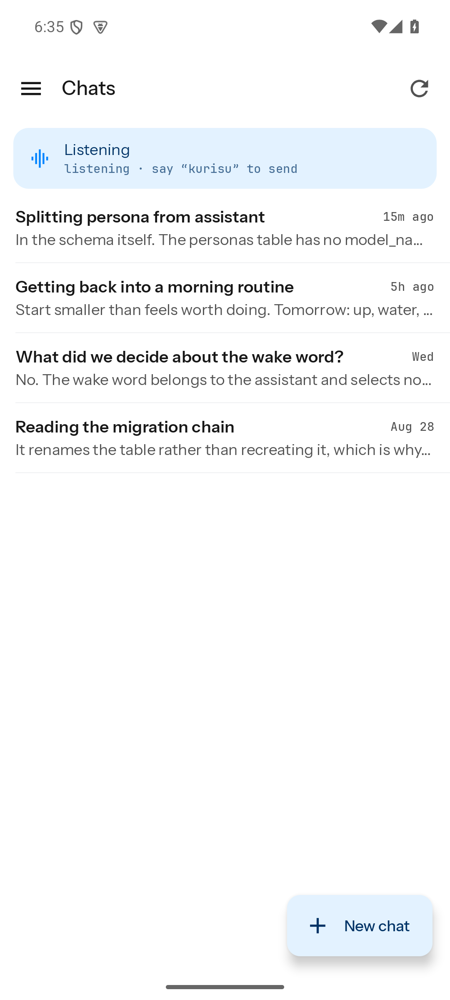

Conversations are what you navigate. A row is its title, when it last moved, and the last thing said
in it. Neither the persona nor the model is on it: a conversation is not tied to a persona (#354) —
one persona, or none, is in use for the whole account and answers every conversation — so a face and
a name would be the same on every row and would tell no two rows apart (#192). Each reply's bubble
names who gave it.

The strip at the top is voice mode: tap it to turn voice mode on or off, as the chat's top-bar
button does (#341). The wake word (`kurisu` here) belongs to the **assistant**, not to any persona:
in voice mode, saying it starts an interaction in a new conversation, and the persona in use
answers. The screenshots predate voice mode's redesign and still show the old strip.

## A conversation

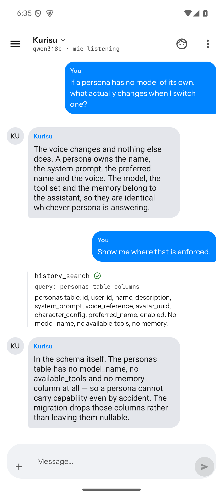

The header names the **model**, and a tap opens the model sheet. It does not name the persona (#365):
the persona changes rarely, so it is switched on **Personas** and each answer's bubble says who gave
it. The right of the bar is voice mode and the menu; **Live character** is in the menu. A hairline
divides the bar from the transcript. Each answer carries the persona that produced it, so switching
persona part-way through does not rewrite the past — old answers keep the voice that actually gave
them. The screenshot predates #365 and still shows the persona over the model.

A tool call is a rail rather than a bubble: name, arguments, result, status. A step the assistant
handed to a sub-agent it spawned (`delegate_task`, #354) is tagged `sub-agent` and names the model
that ran it.

## Switching persona

A row on **Personas** switches the persona **in use for the whole account** (#354): it is saved as
the assistant's `selected_persona_id`, with no message sent, and every conversation — the open one,
the others, new ones, on every device — answers as it from the next turn. A persona is optional
(#302): the first row is **The assistant itself** — no persona. `/persona` in the chat still opens a
sheet that does the same; the header has no way in (#365). The screenshot of that sheet
(`assets/03-persona-sheet.png`) predates #354 and says "This conversation only", so it is not shown
until it is captured again.

## Changing the model

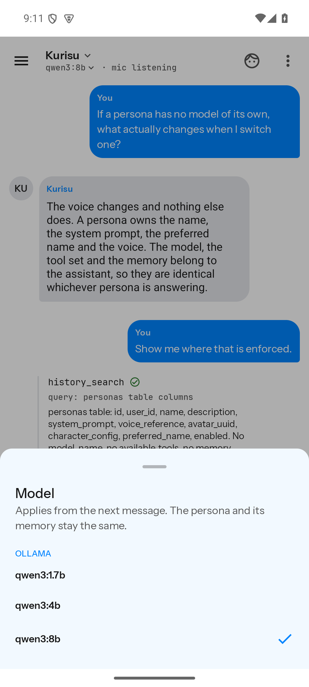

The model name on the header opens this sheet. It is **not** per conversation: the
model is the assistant's, so it changes for every persona, and it applies from the next message.
It is the only model picker in the app — the Assistant page has none — and it is what "Choose a
model" opens when a new account's first message is refused for having no model yet (#197).

## Assistant

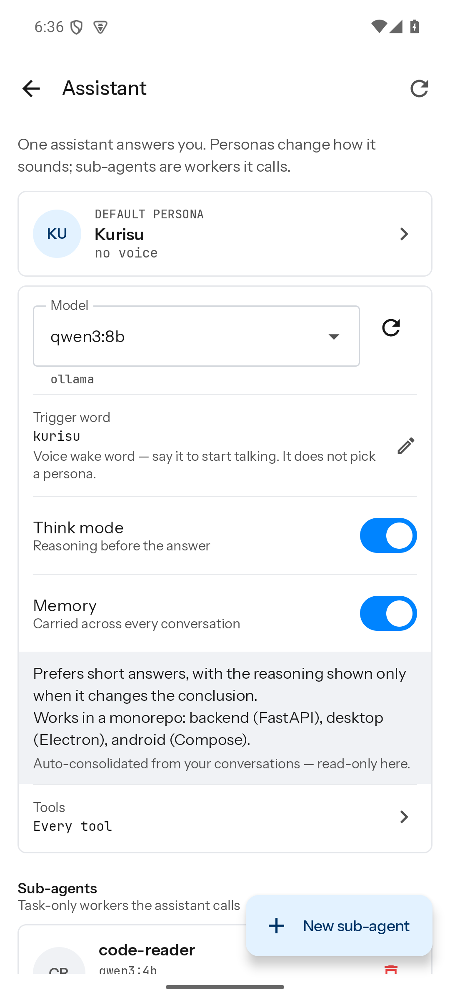

One screen for everything the assistant can do: wake word, thinking, memory, tools. Two things that
look like they belong here do not (#197): the model is picked from the chat header, and the persona
in use is chosen on **Personas** — there is no picker on **New chat**. Memory is a
single document, consolidated automatically from your conversations and read-only here. There are no
sub-agents to set up (#354): the assistant spawns one itself when it wants to hand off a side task.
The screenshot predates that and still shows the old sub-agent list at the bottom.

## Personas

| | |
| --- | --- |
| 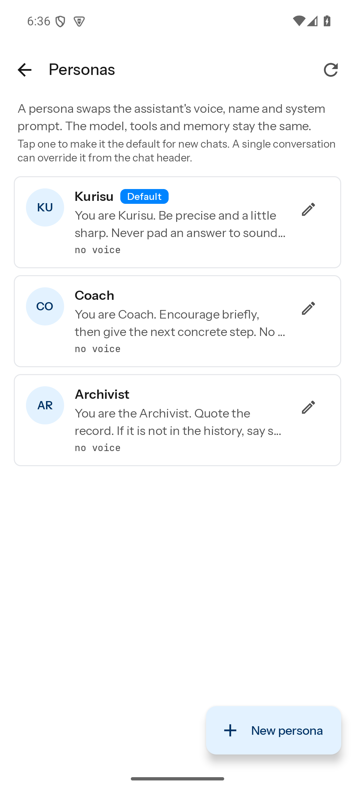 | 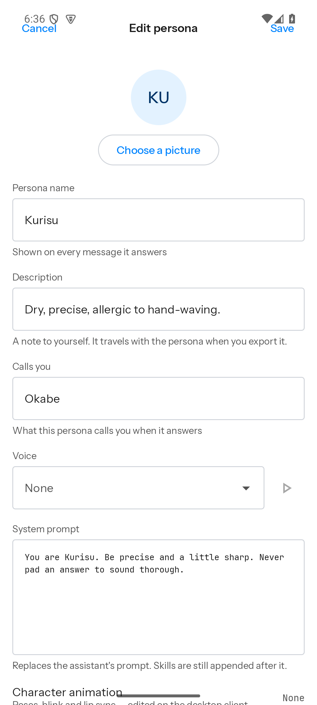 |

A persona carries presentation only — there is no model, no tool list and no wake word in the
editor. "Calls you" is what the persona calls *you*, not a display name for the persona.

Personas are optional (#302). A new account has none, and the list's first row, **The assistant
itself**, is selected until a persona is tapped; tapping a row puts it in use for the whole account,
in every conversation and on every device (`selected_persona_id`, #334, #354), and tapping the
assistant again sends `selected_persona_id: null`
(`AssistantRepository.clearSelectedPersona`, a hand-built body because `AssistantUpdate` never sends a
null). Any persona can be deleted, the last one included, and the selected one can be disabled — both
hand every chat back to the assistant, and the **In the chat** badge follows.

## Everything else

| | |
| --- | --- |
| 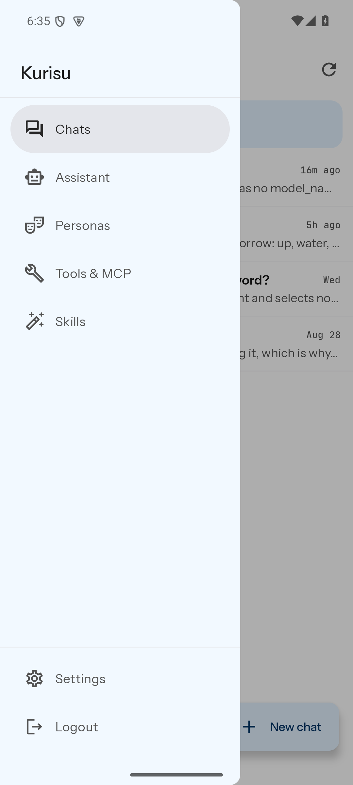 | 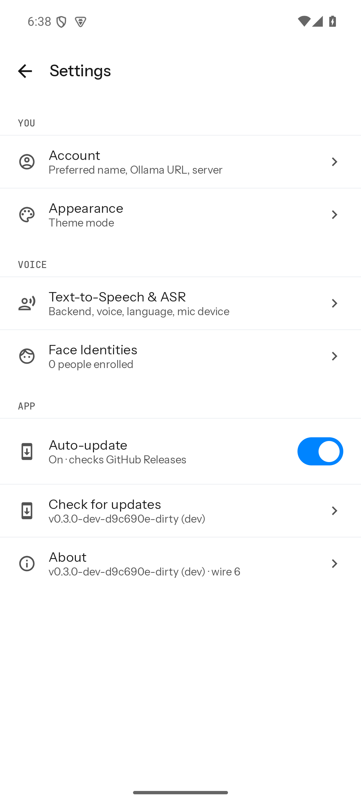 |
| Navigation | Settings |
| 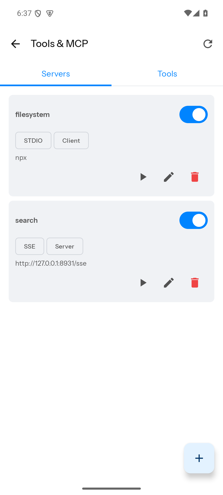 | 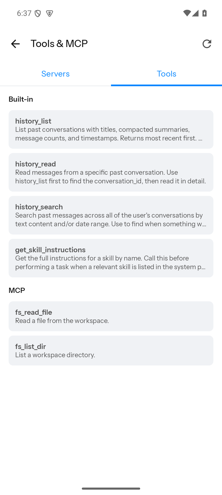 |
| MCP servers, by transport and location | Tools, split built-in from MCP |
| 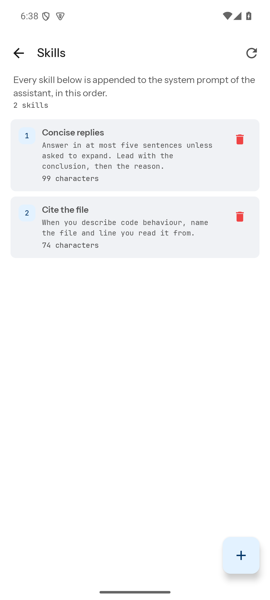 | 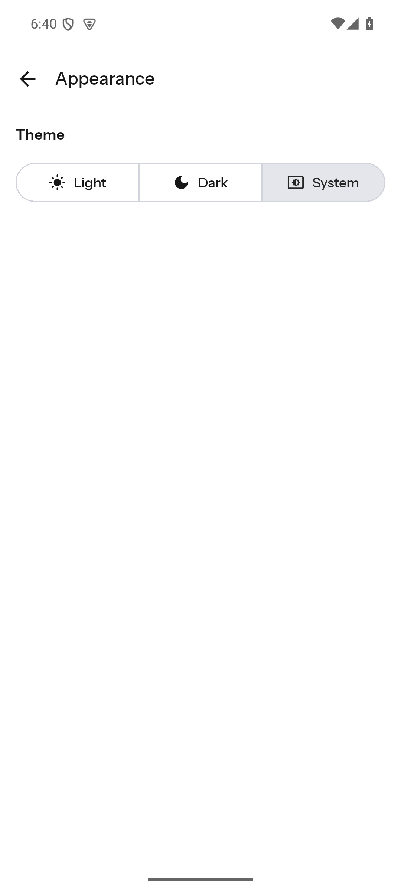 |
| Skills, appended to the assistant's prompt | Light / dark / system |

Account → About is not captured. It shows the app's version and code, the backend's version and wire number, and — since #257 — one sentence when the app and the backend are different releases.

---

## Regenerating these

The app is driven against the **standalone mock backend** from the desktop package — never a
deployed one (the rule in `CLAUDE.md`).

**Every picture on this page comes from `--scenario docs`.** That one scenario furnishes all of
them: three personas, the assistant and its memory, two MCP servers, the built-in
tool descriptions, two skills, and four conversations of different ages — one of which carries the
transcript and the tool rail above. Any other scenario gives an app with nothing in it: before #195
the mock's `/skills` was a hardcoded empty list and `/models` only ever offered `test-model`, so
these pictures could not have come from it and did not. The other scenarios (`tool-call`,
`sub-agent`, `handoff`, …) script a *stream*, and are for watching one arrive; see
[`../../apps/desktop/docs/testing.md`](../../apps/desktop/docs/testing.md#the-standalone-mock).

```bash
# 1. The mock, reachable from the emulator (10.0.2.2 is its route to the host).
#    Dependencies install at clients/ and nowhere else, so npm ci runs there.
cd clients && npm ci
cd apps/desktop && npm run mock:backend -- --host 0.0.0.0 --port 15597 --scenario docs

# 2. Any username and password sign in. Everything the pictures show is already
#    there — no message needs sending.

# 3. A headless emulator
emulator -avd <avd> -no-window -no-audio -no-boot-anim -gpu swiftshader_indirect
./gradlew :app:assembleDevDebug
adb install -r -g app/build/outputs/apk/dev/debug/*.apk

# 4. Point the app at http://10.0.2.2:15597, sign in, then drive and capture.
adb shell uiautomator dump /sdcard/ui.xml   # element bounds, to tap precisely
adb exec-out screencap -p > shot.png
```

Two things that cost time when they are wrong:

- `tool_status` on a scripted tool chunk must be one of `success`, `error` or `denied`. Anything
  else falls through to "running", which looks like a UI bug and is not one.
- The emulator's software GPU is slow enough to raise "System UI isn't responding". Dismiss it and
  carry on; it is not the app.
